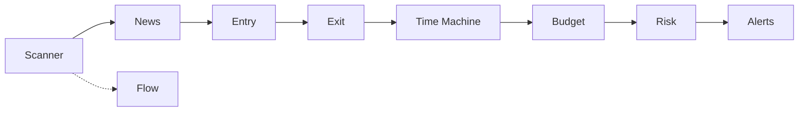

# TradeInsta

> **Algorithmic Trade Analysis, Risk Management & Execution Pipeline for NSE Equities**

TradeInsta is an end-to-end quantitative trading pipeline designed specifically for the National Stock Exchange of India (NSE). It provides intraday setup scanning, corporate news tracking, automated entry timing, tick-rounded stop/target calculations, 10,000-session Monte Carlo simulations, statutory-cost-aware position sizing, strict pre-trade risk controls, and automated price alert monitors.

---

## Architecture & Workflow

The pipeline executes through 9 modular trading skills:



1. **Scanner** (`trader-scanner`): Scans thousands of charts for Opening Range Breakouts (ORB), bull flags, 20-day high breakouts, and oversold bounces. Writes `trader/watchlist.json`.
2. **News** (`trader-news`): Monitors Yahoo Finance headlines and corporate filings (SEC EDGAR / NSE announcements) to detect catalysts and news momentum.
3. **Flow** (`trader-flow`): Parses user-downloaded NSE bulk and block deal CSV reports from `trader/flow/`, surfacing institutional positions and volume anomalies.
4. **Entry** (`trader-entry`): Tracks candle-by-candle price action (1m / 5m bars) and confirms entry on verified bar closes above the opening range with volume filters. Writes `trader/entry.json`.
5. **Exit** (`trader-exit`): Computes tick-accurate stop-losses (e.g., OR midpoint, OR low, ATR) and 1R/2R profit targets before entering. Writes `trader/plan.json`.
6. **Time Machine** (`trader-timemachine`): Replays 10,000 simulated sessions via Monte Carlo bootstrap using 60 days of 5-minute historical bars to calculate win rates, expected R, and odds of target vs. stop.
7. **Budget** (`trader-budget`): Sizes position to fit max loss limits, capital buffers, and Indian statutory transaction costs (Brokerage, STT, Exchange turnover fee, SEBI fee, GST, and Stamp duty). Writes proposed orders to `trader/orders.json`.
8. **Risk** (`trader-risk`): Gatekeeper enforcing daily loss caps, max trades per day, trading time windows (e.g., 09:30–15:00 IST), and reward-to-risk minimums. Emits `PASS` or `BLOCK`.
9. **Alerts** (`trader-alerts`): Monitors real-time quotes, tracks stops, targets, and flat-by-close deadlines (15:15 IST), triggering non-spam single-shot alerts.

---

## Skills Reference

| Skill | Module | Purpose |
|:---|:---|:---|
| **[trader-scanner](.agents/skills/trader-scanner)** | `scan.py` | Chart & ORB breakout scanner for NSE stocks (`.NS`) |
| **[trader-news](.agents/skills/trader-news)** | `news.py` | News monitor for ticker catalysts and filings |
| **[trader-flow](.agents/skills/trader-flow)** | `flow.py`, `big_bull.py` | Institutional bulk/block deals & **BIG BULL** sector flow intelligence |
| **[trader-entry](.agents/skills/trader-entry)** | `entry.py` | Candle-by-candle opening-range breakout entry timer |
| **[trader-exit](.agents/skills/trader-exit)** | `exit.py` | Stop-loss and target planner rounded to ₹0.05 tick size |
| **[trader-timemachine](.agents/skills/trader-timemachine)** | `timemachine.py` | 10,000-session Monte Carlo simulation & backtester |
| **[trader-budget](.agents/skills/trader-budget)** | `size.py` | Position sizer factoring Indian statutory fees |
| **[trader-risk](.agents/skills/trader-risk)** | `check.py` | Pre-trade risk rule validator and gatekeeper |
| **[trader-alerts](.agents/skills/trader-alerts)** | `alerts.py` | Multi-condition price, stop, target & bell alert system |

---

## Key Features

- **NSE & IST Native**: Tailored for Indian markets (`Asia/Kolkata` time zone, 09:15–15:30 IST market hours) with an editable NSE holiday calendar covering 2025, 2026, and 2027.
- **Accurate Indian Statutory Charges**:
  - Brokerage (per order / percentage capped)
  - Securities Transaction Tax (STT)
  - Exchange Turnover Fee
  - SEBI Turnover Charges
  - Goods & Services Tax (GST: 18%)
  - Stamp Duty
- **Risk-First Philosophy**: No trade can be sized or recommended without an explicit stop-loss, risk-reward check, and adherence to daily loss limits.
- **Non-Execution Safety**: Operates purely as an advisory and analysis engine—never directly executes real capital orders without explicit user confirmation.

---

## Project Structure

```
Skill-Trade/
├── .agents/
│   └── skills/                  # Core trading skill implementations
│       ├── trader-alerts/
│       ├── trader-budget/
│       ├── trader-entry/
│       ├── trader-exit/
│       ├── trader-flow/
│       ├── trader-news/
│       ├── trader-risk/
│       ├── trader-scanner/
│       └── trader-timemachine/
├── trader/                      # Runtime state, configurations, and data
│   ├── config.json              # Risk, budget, and statutory charge parameters
│   ├── holidays.json            # NSE trading holidays (2025-2027)
│   ├── sectors.json             # Symbol-to-sector classification registry
│   ├── flow/                    # Downloaded NSE bulk and block deal CSV files
│   └── broker_data.py           # Broker quote and market data adapters
├── tests/                       # Complete unit and regression test suite
│   ├── fixtures/                # Offline market data, flow, and filing fixtures
│   └── test_*.py                # Unit test suite covering all modules
├── app.py                       # Local Streamlit UI dashboard
└── .streamlit/                  # Streamlit configuration (127.0.0.1 binding)
```

---

## Web Dashboard (`app.py`)

TradeInsta includes an interactive local Streamlit dashboard wrapping the trading skills on a single screen:
- **Search**: By company name or NSE ticker symbol (e.g. `RELIANCE`, `Infosys`, `TCS.NS`).
- **Data Source & Bar Age Badge**: Live broker (green), delayed Yahoo (red), market closed (grey), or sample fixture data (purple).
- **Levels & Telemetry**: 15m Opening Range (High/Low), signal status, entry level, stop, and target.
- **Budget & Charges**: Position size and breakdown of statutory charges (STT, brokerage, SEBI, GST, stamp duty) using `trader/config.json`.
- **5-Minute Chart**: Interactive candlestick chart with plotted entry, stop, target, and opening-range levels.
- **Institutional Flow & BIG BULL Intelligence**:
  - **Single Stock Flow**: Latest bulk and block deals (Buy/Sell, quantity, price, stake %) and volume vs. 20-day average.
  - **BIG BULL Terminal**: Market-wide institutional flow analysis, sector capital flow ranking, accumulation detection (repeated buying, multi-buyer breadth, net buy values), volume confirmation, and transparent 0–100 scored watchlist.

Launch locally on `127.0.0.1`:
```bash
streamlit run app.py
```

---

## Configuration (`trader/config.json`)

Key parameters can be customized in `trader/config.json`:

```json
{
  "market": "NSE",
  "timezone": "Asia/Kolkata",
  "budget": 500000,
  "cash_buffer_pct": 10,
  "max_position_pct": 75,
  "max_loss_per_trade_inr": 2000,
  "max_daily_loss_inr": 6000,
  "max_trades_per_day": 3,
  "min_reward_risk": 1.0,
  "require_stop": true,
  "no_entries_before": "09:30",
  "no_entries_after": "15:00",
  "flat_by": "15:15",
  "tick_size": 0.05
}
```

---

## Running Tests

Run the test suite using Python's built-in `unittest`:

```bash
python3 -m unittest discover tests
```

Output:
```text
Ran 303 tests in 6.52s

OK
```

---

## License

MIT License. Designed for quantitative analysis and trade simulation.

